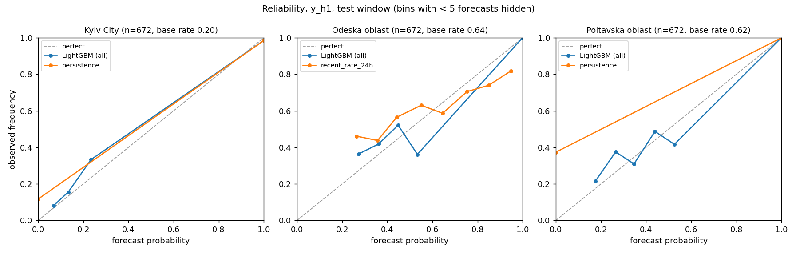
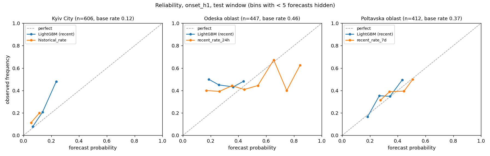
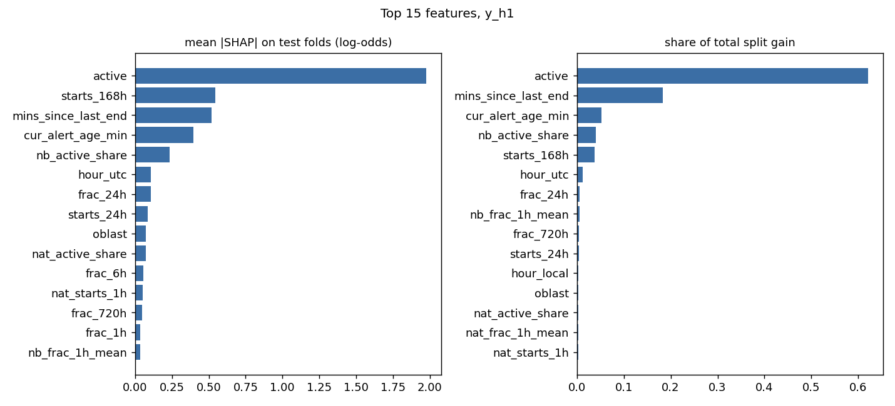
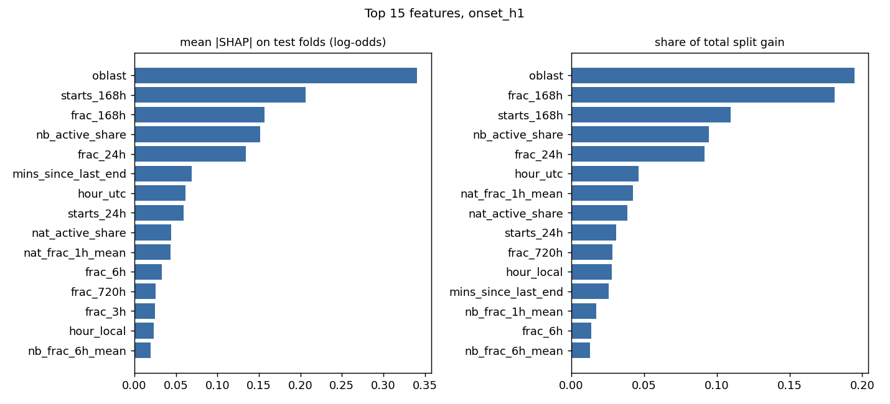

# Air raid alert forecasting for Ukrainian oblasts

Hourly probability forecasts of air raid alerts for three oblasts (Kyiv City, Odeska, Poltavska), evaluated on the
latest clean four weeks of official data with a leakage-tested pipeline.

**Result in one paragraph.** For "any alert in the next hour", LightGBM beats the best baseline in all three oblasts
(Brier skill +0.16 to +0.37). Almost all of that gain comes from hours where no alert is running, because when one
is running every method says "yes". For the harder question, "will a *new* alert start in the next hour", the model
has modest skill in Kyiv City (ROC-AUC 0.68 against 0.61) and essentially none in Odeska and Poltavska. At six hours
the target is nearly constant in Odeska and Poltavska and the model does not beat a 7-day average.

## 1. Problem and targets

People and services plan around alerts: whether to start a commute, a surgery, a delivery run. A calibrated
short-horizon probability is more useful than the alert map alone, which only shows the present.

- **Unit and grid.** One oblast, hourly, UTC.
- **Forecast time `t`.** The start of an hour. A forecast at `t` may use only information from strictly before `t`.
- **Alert definition.** An oblast is under alert if any official alert at any level (oblast, raion, hromada) inside
  it is running. Overlapping alerts are merged into intervals.
- **Primary target `y_h{H}`.** 1 if the oblast is under alert at any moment in `[t, t+H)`, for H = 1, 3, 6 hours.
- **Onset target `onset_h{H}`.** The same event, scored only on hours where no alert is running at `t`. On those
  hours "any alert in the window" and "a new alert starts in the window" are the same thing. This is the honest
  target: on the primary one, copying the current state already scores well.

## 2. Data

- **Source.** [Vadimkin/ukrainian-air-raid-sirens-dataset](https://github.com/Vadimkin/ukrainian-air-raid-sirens-dataset)
  (MIT), file `datasets/official_data_en.csv`, commit `d10c80fa696bab42822b9f05b423fc8a30e79d20`, retrieved
  2026-10-12. Timestamps are UTC (checked four ways, D4).
- **Rejected sources.** alerts.in.ua API (about 30 days of history, needs a token); Tyrrrz/RaidTrend (archived 2022).

What verification found (full evidence in [DECISIONS.md](DECISIONS.md)):

| | Finding | Consequence |
|---|---|---|
| D1 | The official file ends on 2026-09-07; the source Telegram channel stopped posting that day | "Updated daily" is not true for this file |
| D2 | 113,845 of 299,275 rows are exact duplicates (history appended twice) | Exact de-duplication, logged |
| D3 | No rows from 2026-08-29 04:55 to 2026-09-02 13:48 UTC; 31 alerts "span" the hole | Test window ends before it |
| D5 | The volunteer file is fresh, but after the raion reform it files alerts under the wrong oblast (Lviv hourly agreement with the official file drops from 0.82 to 0.12 Jaccard) | Rejected as primary source |
| D6 | The switch to raion-level alerts came in two steps, August and November 2025; row counts quadruple | Target is a union over all levels |
| D7 | Orphaned alerts are closed at start + 1 h by the scraper (255 rows); unfinished alerts are never written | Flagged, kept; last hours of the file undercount |

**Splits (UTC, half-open).** Train before 2026-07-03 · validation 2026-07-03 → 2026-07-31 · test 2026-07-31 →
2026-08-28. The test window is the last four full weeks before the outage.

**Why these oblasts.** With the any-level definition, frontline oblasts are under alert 90–100% of hours, so there
is nothing to forecast (D8). Kyiv City, Odeska and Poltavska have alerts in 13%, 39% and 50% of hours.

## 3. Leakage prevention

1. **Features are closed-form functions of time** ([src/features.py](src/features.py)). Every feature is built from
   F(x) = seconds of alert before instant x and N(x) = alert starts before x, evaluated only at x ≤ t, plus "is an
   alert running at t". No `rolling()`, no resampling. The end time of a running alert is never read.
2. **Truncation test** ([tests/test_leakage.py](tests/test_leakage.py)). For sampled hours t the raw alerts are cut
   at t (later starts removed, end times ≥ t erased), features are rebuilt from that alone and compared with the full
   pipeline: 60 hours on synthetic alerts, 40 on real data (15 inside the test window), all three oblasts.
3. **Negative control.** A feature that looks one hour ahead is added on purpose; the same test must reject it, and
   does.
4. **Purge rule.** A training row at time s is used in a fit with cut-off c only if s + H ≤ c, so its outcome window
   had closed ([tests/test_splits.py](tests/test_splits.py)).
5. **Walk-forward with equal information.** Four weekly test folds; LightGBM and the historical-rate baseline are
   both refitted at each fold start. All methods are scored on identical rows.
6. **No test-set tuning.** Hyperparameters, rounds, training window and the comparison baseline were all chosen on
   validation (D13–D15). The test window was scored once.

Neighbour and nationwide features use other oblasts' state as known at `t`, never anything from `[t, t+H)`.

## 4. Results on the test window (2026-07-31 → 2026-08-28)

LightGBM: one model per target, pooled over the three oblasts, 28 features plus oblast. "all" = trained on all
history, "recent" = trained on data from 2025-11-01 only; the one shown was chosen on validation. The baseline shown
is the one with the lowest validation Brier for that oblast and target. Skill = 1 − Brier(model) / Brier(baseline).

**Any alert in the next hour (`y_h1`)**

| Oblast | Hours | Base rate | Model | Brier | Log-loss | ROC-AUC | PR-AUC | Skill vs baseline |
|---|---|---|---|---|---|---|---|---|
| Kyiv City | 672 | 0.202 | LightGBM (all) | 0.090 | 0.319 | 0.822 | 0.730 | +0.157 |
| | | | persistence | 0.107 | 0.741 | 0.738 | 0.576 | |
| Odeska | 672 | 0.640 | LightGBM (all) | 0.168 | 0.465 | 0.777 | 0.890 | +0.272 |
| | | | recent rate 24 h | 0.230 | 0.663 | 0.593 | 0.713 | |
| Poltavska | 672 | 0.616 | LightGBM (all) | 0.144 | 0.407 | 0.831 | 0.916 | +0.372 |
| | | | persistence | 0.229 | 1.584 | 0.814 | 0.857 | |

**New alert starts in the next hour (`onset_h1`)**

| Oblast | Hours | Base rate | Model | Brier | Log-loss | ROC-AUC | PR-AUC | Skill vs baseline |
|---|---|---|---|---|---|---|---|---|
| Kyiv City | 606 | 0.117 | LightGBM (recent) | 0.098 | 0.341 | 0.683 | 0.278 | +0.070 |
| | | | historical rate | 0.106 | 0.380 | 0.610 | 0.159 | |
| Odeska | 447 | 0.459 | LightGBM (recent) | 0.255 | 0.706 | 0.526 | 0.480 | +0.001 |
| | | | recent rate 24 h | 0.256 | 0.719 | 0.560 | 0.519 | |
| Poltavska | 412 | 0.374 | LightGBM (recent) | 0.233 | 0.658 | 0.559 | 0.434 | +0.008 |
| | | | recent rate 7 d | 0.234 | 0.662 | 0.545 | 0.408 | |

**3 h and 6 h horizons**

| Oblast | Target | Base rate | LightGBM Brier | Baseline | Baseline Brier | Skill | LightGBM ROC-AUC |
|---|---|---|---|---|---|---|---|
| Kyiv City | `y_h3` | 0.345 | 0.170 | persistence | 0.250 | +0.318 | 0.747 |
| Kyiv City | `onset_h3` | 0.276 | 0.187 | historical rate | 0.210 | +0.109 | 0.670 |
| Kyiv City | `y_h6` | 0.475 | 0.206 | historical rate | 0.264 | +0.220 | 0.729 |
| Kyiv City | `onset_h6` | 0.419 | 0.226 | historical rate | 0.256 | +0.117 | 0.676 |
| Odeska | `y_h3` | 0.885 | 0.102 | recent rate 24 h | 0.109 | +0.066 | 0.691 |
| Odeska | `onset_h3` | 0.828 | 0.164 | recent rate 7 d | 0.151 | -0.087 | 0.499 |
| Odeska | `y_h6` | 0.978 | 0.027 | recent rate 7 d | 0.023 | -0.170 | 0.577 |
| Odeska | `onset_h6` | 0.966 | 0.040 | recent rate 7 d | 0.035 | -0.150 | 0.355 |
| Poltavska | `y_h3` | 0.850 | 0.118 | recent rate 7 d | 0.129 | +0.081 | 0.751 |
| Poltavska | `onset_h3` | 0.755 | 0.192 | recent rate 7 d | 0.189 | -0.019 | 0.549 |
| Poltavska | `y_h6` | 0.957 | 0.043 | recent rate 7 d | 0.042 | -0.013 | 0.719 |
| Poltavska | `onset_h6` | 0.930 | 0.070 | recent rate 7 d | 0.069 | -0.023 | 0.520 |

Every baseline and both training windows, for all targets: [reports/results_test.csv](reports/results_test.csv).

### How to read this

- **`y_h1` looks strong, but mostly restates the present.** When an alert is running at `t`, the answer is 1 almost
  by definition, and persistence already gets those hours right. The model's whole advantage over persistence is on
  the no-alert hours, which is exactly the onset target.
- **Onset: real but small skill in Kyiv City, none in Odeska and Poltavska.** In Kyiv City the model separates hours
  better than any baseline (ROC-AUC 0.68 against 0.61). In Odeska its ROC-AUC (0.53) is *below* the 24-hour recent
  rate (0.56) and the Brier scores are equal to three decimals; in Poltavska the difference is +0.008. With only
  alert history as input, the model cannot say much more than "it has been busy lately".
- **Six hours ahead is not a forecasting problem in Odeska and Poltavska.** The target is positive in 96–98% of test
  hours (D9). A 7-day average is already near-perfect and the model is slightly worse (skill −0.01 to −0.17).
- **All history against recent only.** Test Brier differs by at most 0.012 between the two training windows, and
  usually by a few thousandths. Training on eight months does as well as on four and a half years.
- **Calibration.** In Kyiv City the model is close to the diagonal but under-forecasts in its top bin. In Odeska the
  onset forecasts are flat: observed frequency is 0.43–0.50 whatever the model says.




### What the model uses

Importance is measured two ways with LightGBM's own tools: share of total split gain, and mean absolute TreeSHAP
contribution on the test folds (`pred_contrib=True`).

- **The `y_h1` model is mostly persistence.** `active` takes 62% of the gain and has a mean |SHAP| of 1.98 log-odds,
  3.6 times the next feature. Time since the last alert ended (18% of gain) and alert starts in the last 7 days do
  the rest.
- **The `onset_h1` model is a rate estimator.** Its top features are the oblast itself, alert starts and alert share
  over the last 7 days, the share of neighbours under alert, and the last-24-hour share. Hour of day matters little.




## 5. Robustness checks (not headline results)

Both reuse the model configuration chosen on the official validation split; nothing was re-tuned.
All horizons are in `reports/results_sep_check.csv` and `reports/results_volunteer.csv`.

### 5a. Freshest official data: 2026-09-03 → 2026-09-06

Three days after the outage, models fitted on data up to 2026-08-28 (D16). **Lookback windows partially cover an
outage**: the 7-day and 30-day features, the seasonal-naive baseline and the 7-day recent-rate baseline all look
into hours with no recorded alerts, and so do the 24-hour ones for the first 14 hours of the window. The 31 alerts that "span" the outage were
removed from the features. The window stops a day before the end of the file because alerts still running at the
end were never written.

| Oblast | Target | Hours | Base rate | LightGBM Brier | LightGBM ROC-AUC | Baseline | Baseline Brier | Baseline ROC-AUC | Skill |
|---|---|---|---|---|---|---|---|---|---|
| Kyiv City | `y_h1` | 72 | 0.597 | 0.142 | 0.957 | persistence | 0.236 | 0.802 | +0.399 |
| Kyiv City | `onset_h1` | 46 | 0.370 | 0.236 | 0.844 | historical rate | 0.330 | 0.499 | +0.285 |
| Odeska | `y_h1` | 72 | 0.625 | 0.215 | 0.739 | recent rate 24 h | 0.239 | 0.553 | +0.101 |
| Odeska | `onset_h1` | 52 | 0.481 | 0.298 | 0.498 | recent rate 24 h | 0.264 | 0.530 | -0.130 |
| Poltavska | `y_h1` | 72 | 0.861 | 0.115 | 0.860 | persistence | 0.194 | 0.887 | +0.406 |
| Poltavska | `onset_h1` | 24 | 0.583 | 0.348 | 0.429 | recent rate 7 d | 0.469 | 0.514 | +0.257 |

- **Too small to rank methods.** 72 hours per oblast, 24–52 for the onset target.
- **The clean comparison holds.** Against persistence, which does not look back into the outage, LightGBM keeps its
  advantage on `y_h1` in Kyiv City and Poltavska (skill +0.40 and +0.41).
- **Odeska onset still shows no skill** (ROC-AUC 0.50, skill −0.13), the same as in the main test.
- **Skill against the 7-day recent rate at 3 h and 6 h is inflated** (up to +0.96 in the CSV): that baseline is
  broken by the outage here, so those numbers say nothing about the model.
- This was an unusually intense period: Kyiv City had an alert in 60% of hours, against 20% in the main test window.

### 5b. Volunteer file: 2026-09-13 → 2026-10-11

The same pipeline on `volunteer_data_en.csv`, four weekly folds (D17). **Labels cannot be verified for this window**
because the official source had stopped, and after the raion reform this file files alerts under the wrong oblast
for several oblasts (D5). Kyiv City is the least affected of the three (hourly Jaccard with the official file 0.638
after the reform), so it is listed first, but 35 of its 128 alerts in this window have an imputed 30-minute end.

| Oblast | Target | Hours | Base rate | LightGBM Brier | LightGBM ROC-AUC | Baseline | Baseline Brier | Baseline ROC-AUC | Skill |
|---|---|---|---|---|---|---|---|---|---|
| Kyiv City | `y_h1` | 672 | 0.286 | 0.149 | 0.682 | persistence | 0.183 | 0.680 | +0.187 |
| Kyiv City | `onset_h1` | 603 | 0.204 | 0.165 | 0.509 | recent rate 7 d | 0.164 | 0.459 | -0.004 |
| Odeska | `y_h1` | 672 | 0.408 | 0.196 | 0.692 | recent rate 24 h | 0.244 | 0.563 | +0.199 |
| Odeska | `onset_h1` | 599 | 0.336 | 0.220 | 0.572 | recent rate 7 d | 0.225 | 0.494 | +0.021 |
| Poltavska | `y_h1` | 672 | 0.438 | 0.178 | 0.754 | recent rate 7 d | 0.251 | 0.494 | +0.289 |
| Poltavska | `onset_h1` | 559 | 0.324 | 0.217 | 0.587 | recent rate 7 d | 0.222 | 0.524 | +0.024 |

- **Same shape as the official result.** Positive skill on `y_h1` in all three oblasts (+0.19 to +0.29) and no
  meaningful skill on `onset_h1` (−0.004 to +0.024, ROC-AUC 0.51–0.59).
- **Kyiv City onset skill does not carry over** (ROC-AUC 0.51 here, 0.68 on official labels). Whether that is the
  later period or the noisier labels cannot be separated with this data.

## 6. Limitations

- **The test window is about six weeks old.** The official source stopped on 2026-09-07 and has an outage just
  before that, so 2026-07-31 → 2026-08-28 is the latest period with trustworthy labels (D1, D3).
- **Three oblasts.** Frontline oblasts are near-constant under this alert definition and were left out (D8).
- **One four-week window.** 400–670 scored hours per oblast; small differences (below about 0.01 Brier) are noise.
- **Regime shift.** Alert rates in the test window are far above the training average (Odeska 0.18 in train, 0.64
  in test), which hurts every method fitted on history.
- **Label noise.** Some end times are imputed by the scraper (start + 1 h), and a re-sent alert within three hours
  overwrites the original start (D7).
- **Alert history only.** No information about what is in the air, which is what actually drives onsets.

## 7. Future work

- Text sources such as Telegram monitoring channels, using publish time only and ignoring edited posts.
- Raion-level targets, which is how alerts have been issued since late 2025.
- More oblasts, with an alert definition that is not saturated on the front line (for example oblast-wide share).

## 8. Reproduce

```bash
git clone https://github.com/lyaroshenko/air-alert-forecast-ua.git
cd air-alert-forecast-ua
git clone https://github.com/Vadimkin/ukrainian-air-raid-sirens-dataset.git external/ukrainian-air-raid-sirens-dataset
git -C external/ukrainian-air-raid-sirens-dataset checkout d10c80fa696bab42822b9f05b423fc8a30e79d20
python -m venv .venv
.venv/Scripts/python -m pip install -r requirements.txt    # Linux/macOS: .venv/bin/python
.venv/Scripts/python -m src.run --test
.venv/Scripts/python -m src.robustness --check sep          # section 5a
.venv/Scripts/python -m src.robustness --check volunteer    # section 5b
.venv/Scripts/python -m pytest -q
```

`src.run` executes, in order: `src.data` (clean, merge intervals), `src.target` (hourly targets), `src.features`,
`src.evaluate --split val` (baselines), `src.train` (model selection on validation), and with `--test`
`src.evaluate --split test` (walk-forward). Outputs go to `reports/`. Python 3.12, versions pinned in
`requirements.txt`, fixed seed.

Checked on 2026-10-12 from a clean clone of this repository (Windows 11, Python 3.12.2): all commands above ran
without errors, 27 tests passed, and every regenerated file in `reports/` was identical to the committed one. In that
check the dataset was cloned from a local copy at the same commit rather than from GitHub. On Windows, clone into a
short path: the dataset repository fails with "Filename too long" under deeply nested directories.

## How this was built

Development was AI-assisted (Claude Code). [CLAUDE.md](CLAUDE.md) is the guardrail file with the task definition
and the leakage rules the assistant had to follow; [DECISIONS.md](DECISIONS.md) is the audit trail of every data
issue and design decision, including the ones that reversed an earlier plan (the volunteer file, the Kharkiv
oblast choice, the definition of "active at t").

## Layout

```
src/data.py        load, de-duplicate, merge alerts into per-oblast intervals
src/target.py      hourly grid and targets
src/features.py    leakage-safe features
src/baselines.py   persistence, seasonal naive, historical rate, recent rate
src/train.py       LightGBM, validation-only model selection
src/evaluate.py    metrics, walk-forward, plots
src/run.py         run everything
src/robustness.py  September and volunteer-file checks
tests/             target, splits and purge rule, leakage, baselines
reports/           result tables and figures
```
